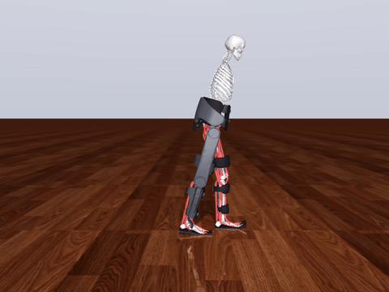
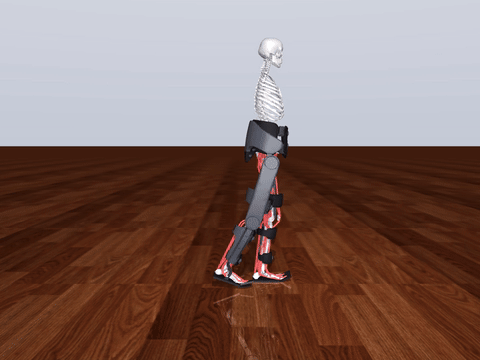

# indego_sim

A MuJoCo simulation of a person - healthy or with a spinal cord injury - wearing an Indego lower-limb
exoskeleton, for designing and testing exoskeleton controllers before lab sessions.

<table>
  <tr>
    <td width="50%"><a href="results/own_walking_sci_t12_aisD_zero.mp4"></a></td>
    <td width="50%"><a href="results/own_walking_healthy_zero.mp4"></a></td>
  </tr>
  <tr>
    <td>Incomplete SCI (T12 AIS D)</td>
    <td>Healthy</td>
  </tr>
</table>

Each person walks on their own in the zero-torque exo, without crutches or help: 30 s on 8/8 seeds (sagittal-plane
model, 30 ms reaction delay, walking parameters tuned per person).

## What's inside

- **The device as a controller sees it**: Indego geometry and mass, hip and knee drive models, onboard sensors with
  latency and noise, compliant cuffs.
- **A user with their own behaviour**: a musculoskeletal model (MyoSuite MyoLeg, 80 muscles) with intent, delayed
  voluntary control, reflexes, and SCI weakness and spasticity.
- **Controllers and tools**: Indego-like, transparent and assist-as-needed controllers, a Gymnasium environment,
  system identification.

## Quick start

```bash
pip install -r requirements.txt
git clone https://github.com/MyoHub/myo_sim && pip install --no-deps -e myo_sim
python examples/01_own_walking.py --video
```

## Documentation

[Model](docs/MODEL.md) · [Status](docs/STATUS.md) · [Development](docs/DEVELOPMENT.md) · [Results](results/README.md)

The exo meshes are not included (commercial 3D model); the simulation runs without them.
