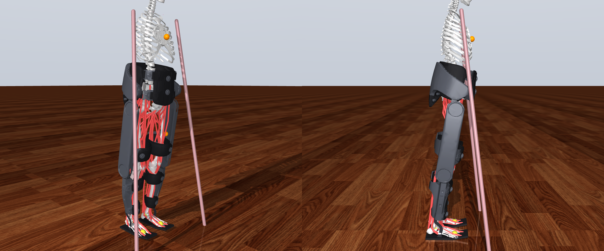

# The model

What is simulated, how the parts connect and where they live in the code. The parameters and their provenance
are listed in [PARAMETERS.md](PARAMETERS.md); modelling decisions in [MODELING_NOTES.md](MODELING_NOTES.md).



## Signal flow

```
 volition (wants to stand / lean / step, cadence, effort)        your controller (obs -> 4 torques, 200 Hz)
        │                                                                ▲                 │
        ▼                                                                │ encoders, IMUs, │
 voluntary layer (SO, 60 ms delay) ─┐                                    │ motor current   ▼
 spinal layer (reflex, spasticity,  ├─► 80 Hill muscles (MyoLeg) ◄── cuffs (6-DOF bushings) ◄── Indego frame
   clonus, spasms; 1 kHz)          ─┘   + trunk                          hip belt, thigh, shank, shoe/AFO
 arms: crutches / walker / harness / therapist (delayed + intrinsic)     dcmotor drives (current loop, back-EMF,
                                                                          friction, cogging, thermal, delay)
```

The controller gets only what the real device measures (encoders, IMUs, motor current) and sends four joint
torques at 200 Hz; the person acts with their own intent, delayed voluntary control and spinal reflexes. Timing:
physics 0.5 ms, human tick 1 kHz, voluntary static optimisation every 10 ms with a 60 ms long-loop delay,
controller 200 Hz with ~10-11 ms loop latency.

## Components

| part | what is modelled | where |
|---|---|---|
| Exo geometry | hip unit / thigh / shank / AFO plate measured on a 3D model of the Indego (un-posed, axes found from the shells), scaled to the subject's femur/tibia. The segment meshes are not distributed; without them each segment is a box with the mesh's mass properties | `model/builder.py`, `tools/` |
| Exo inertia | masses from the Indego spec (12.3 kg Personal; `ExoParams.therapy()` 17.7 kg), distributed on the segment shells, battery and motors as point masses | `config.ExoParams` |
| Joints | powered hip & knee (Indego ranges), passive frontal-plane hip compliance and thigh twist, AFO either **free** or **quasi-static spring** (never locked), optional gear backlash, knee brakes | `model/builder.py` |
| Human–exo interface | 6-DOF visco-elastic bushings with strain stiffening + soft-tissue wobbling mass at hip belt, thigh cuff, 2 shank cuffs, shoe; axis misalignment | `BushingParams` |
| Drives | MuJoCo `dcmotor`: torque-mode driver with back-EMF compensation, voltage limit, current loop lag, rotor inertia, viscous + Coulomb (or LuGre) friction, cogging, copper heating; firmware current limits and thermal fold-back | `exo/drive.py` |
| Sensors | 14-bit encoders, filtered-difference velocity, motor current, three IMUs, hip AHRS; MuJoCo sensor `interval`/`delay` + noise, bias, dropouts | `exo/sensors.py` |
| Add-on trunk IMU | strapped on the sternum or between the shoulder blades (placed from the rib-cage mesh), own rate / latency / strap misalignment; `SensorParams.trunk_imu="none"` for the stock device | `model/builder.py` |
| Human | MyoLeg 80 muscles / 29 DOF + 3 lumbar DOF, scaled to height/mass; shoe soles (9.5 cm wide, toe spring) instead of MyoLeg's narrow bare-foot contacts | `model/builder.py` |
| Volition | stand / lean / walk / stop / cadence session scripts, gait oscillator entrained by heel strikes, cooperation/resistance, slacking, spurious leans | `human/volition.py` |
| Voluntary control | 60 ms delayed PD + gait-template feedforward → static optimisation (muscle capacity limits = SCI weakness); ankle/hip balance strategy. Own walking (`gait_mode="walk"`): SIMBICON-style foot placement and trunk control through the muscles, gait initiation, double-support weight transfer, internal forward model; parameter sets tuned per person | `human/controller.py`, `config.HumanWalkParams` |
| Spinal layer | stretch reflex, spasticity (TSRT threshold model from Modified Ashworth), clonus (delay × gain), Poisson & stretch-triggered extensor/flexor spasms; location-dependent delays | `human/reflexes.py` |
| SCI | ISNCSCI motor scores / NLI / AIS → per-muscle capacity, disuse atrophy, passive stiffness; presets T10 A, T5 A, L2 C, T12 D | `human/sci.py` |
| Upper limbs | crutches/walker: ground reaction through each tip within the friction cone, per-arm load cap, shoulder-moment cap, stiff "locked-arm" struts while the exo steps, delayed postural controller (COM about the feet' centre of pressure + trunk orientation + heading), crutch moves in double support with lateral-safety and reach rules, leaning further when the exo does not respond; overhead BWS harness on a trolley; therapist guarding (logged assistance) | `human/support.py` |
| Controllers | Indego-like FSM (lean-to-step from the exo's own COM estimate — segment model, uses the trunk IMU when fitted — step-length-dependent double-support threshold and lateral weight check as in the Vanderbilt controller, min-jerk steps, lean/auto/external triggers), foot-placement dynamic walking (experimental), transparent mode, assist-as-needed | `controllers/` |
| RL / design env | Gymnasium env, 44-D obs at 200 Hz (34 stock + 10 trunk IMU), ground truth in `info`, per-episode randomisation of drives, cuffs, sensors (incl. trunk-IMU strap misalignment), volition, support, spasticity | `env.py` |
| System ID | excitation signals, virtual single-joint bench, friction map, rigid-body + delay fit, FRF, current loop, thermal; pendulum-test spasticity fit | `sysid/` |

## Code layout

```
indego_sim/
  config.py            all parameters (dataclasses) + YAML loading + randomisation
  sim.py               HumanExoSim: one closed-loop session, logging, events
  env.py               Gymnasium environment
  model/builder.py     MjSpec assembly of MyoLeg + Indego, cuffs, drives, sensors, keyframe
  exo/                 drive firmware layer, onboard sensors
  human/               muscles + static optimisation, reflexes, SCI, volition, controller, support
  controllers/         Indego-like FSM, foot-placement dynamic walking, transparent, assist-as-needed
  sysid/               excitation, bench, actuator_id, spasticity (pendulum test)
  assets/indego/       exo segment meshes (optional, not distributed; see docs/DEVELOPMENT.md)
tools/                 mesh processing, docs generator, overview renderer, crutch-strategy fitting
tools/diag/            walking diagnostics, own-walking evaluation and tuning
examples/ tests/ docs/ results/
```
